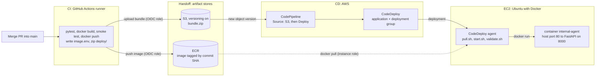

# CI/CD v1 Design

| | |
|---|---|
| Status | Draft, pending mentor review. Repo files implemented 2026-11-26; AWS setup in progress ([aws-setup.md](aws-setup.md)). |
| Last updated | 2026-11-26 |
| Scope | Hello-world FastAPI app, deployed to one EC2 instance |

> The decisions in this document come from the project's learning notes and Decision Log, which live outside this repository. Config snippets here are illustrative. The real files are generated in step 5 of the [implementation order](#10-implementation-order) and may differ in structure and naming. Anything the notes leave open is listed under [Open questions](#11-open-questions) instead of being decided here.

## 1. Goal and scope

### Goal

On every merge to `main`, automatically test, build and deploy a hello-world FastAPI app that exposes `GET /api/health` to a single EC2 instance, with no manual step.

The pipeline comes before the application, as the mentor asked ("scaffolding before the house"). Every later API change has to be tested in the cloud, and without automation each change would mean a manual deploy. A hello-world app is also simple enough that any failure during setup is a pipeline problem, not an application bug.

### Definition of done

- A merge to `main` produces an image in ECR tagged with the merge commit's full SHA.
- With no manual step, the container on EC2 switches to that image.
- The ValidateService hook passes, which means `curl -f http://localhost/api/health` succeeds on the instance (host port 80, mapped to container port 8000).
- `docker ps` on EC2 shows the SHA of the latest commit on `main`.
- A pull request runs the tests and an image build, but never pushes or deploys.

### In scope

- A GitHub Actions workflow that tests, builds, pushes the image and uploads the bundle, authenticated to AWS through OIDC.
- A Docker image in ECR and a deploy bundle in a versioned S3 bucket.
- CodePipeline (Source: S3, then Deploy) and an in-place CodeDeploy deployment to one EC2 instance.
- Three deploy scripts: pull, start and validate.
- One-time AWS setup done by hand in the console, with every change written down so it can become Terraform later.

### Out of scope for v1

| Item | Why it is deferred |
|---|---|
| React frontend | Not built yet. Its hosting is still a pending decision. |
| ALB and HTTPS | The ALB entry point is pending. It is needed for blue/green and for more than one instance. |
| Rollback, manual or automatic | v1 only has to deploy the latest version. The design keeps rollback possible ([§3](#rollback-not-in-v1)). |
| Blue/green and zero-downtime deploys | These need a second set of instances and a load balancer. v1 accepts a few seconds of downtime per deploy. |
| Staging, multiple environments, manual approval | These become extra CodePipeline stages later. |
| Terraform | v1 resources are created in the console. |
| ECS / Fargate | A possible future home for the API layer. Only the bundle-and-scripts half of this design would change. |
| CI build cache, ECR lifecycle policy | Optimizations. A lifecycle policy must not delete images that a rollback would need. |
| Model layer (vLLM on GPU EC2), application secrets | Later phases. |

There is no approval step, so strictly speaking v1 is continuous deployment, not continuous delivery. Adding a manual approval stage in CodePipeline would turn it into continuous delivery.

## 2. Architecture and flow



1. A pull request is merged into `main`. The merge is a push to `main`, which triggers the workflow.
2. GitHub Actions runs pytest, builds the image, smoke-tests a container started from it, and assumes the GitHub OIDC role. It then pushes `<registry>/<ecr-repo>:<sha>` to ECR, writes `deploy/image.env`, zips `deploy/` and uploads the zip to S3 as `bundle.zip`.
3. The upload creates a new object version, and the new version starts a CodePipeline execution.
4. The Source stage picks up the bundle, and the Deploy stage hands it to CodeDeploy.
5. CodeDeploy starts a deployment for the deployment group, which finds the instance by its EC2 tag.
6. The CodeDeploy agent on the instance downloads the bundle, copies it to `/opt/internal-agent/deploy` and runs the hooks in order: `pull.sh`, `start.sh`, `validate.sh`.
7. The deployment succeeds only if every hook exits with 0.

### Where the CI/CD boundary sits

- GitHub Actions is CI. CodePipeline and CodeDeploy are CD. The handoff happens when the image is in ECR and the bundle is in S3.
- ECR and S3 only store things. The three parts that do work are Actions, CodePipeline and CodeDeploy.
- A green Actions run therefore only proves that both artifacts were delivered. It does not prove the deployment worked ([§9](#9-verification-and-troubleshooting)).
- Tests, `docker build` and `docker push` all run in Actions. Nothing is built on EC2. The instance never contacts GitHub and holds no GitHub credentials.

### How this differs from the mentor's high-level flow

The mentor's flow (2026-10-27) is: Actions tests and builds the image, a container started from the image passes tests, the image goes to ECR, Actions triggers CodePipeline and CodeDeploy, and EC2 pulls the image and runs it. This design differs in two places. Both still need the mentor's confirmation:

1. pytest runs against the code before the build, and the CI also smoke-tests a container started from the image before pushing it. The smoke test was adopted on 2026-11-26 to match the mentor's flow ([Q1](#q1-smoke-test-the-container-before-pushing)).
2. Actions does not trigger CodePipeline directly. The new S3 object version does ([Q2](#q2-what-triggers-codepipeline)).

## 3. The two artifacts

Every deployment moves two things:

| | Docker image | Deploy bundle (`bundle.zip`) |
|---|---|---|
| What it is | The application: FastAPI code, the Python runtime and dependencies | Deployment instructions: `appspec.yml`, three scripts and `image.env` |
| Where it lives | ECR, tagged with the commit SHA | S3, always the same key, with bucket versioning on |
| Who uses it | `pull.sh` on EC2 runs `docker pull` | CodeDeploy delivers it to EC2, and the agent runs it according to `appspec.yml` |

The image is the cargo and the bundle is the delivery note. CodeDeploy only reads the delivery note.

### The image

- It holds the whole application: the Python runtime, pinned dependencies, the full `src/` directory and the `CMD`. Every image is a complete snapshot, not a diff. Push and pull only transfer the layers that the other side does not have yet.
- The tag is the full commit SHA (`github.sha`), never `latest`. `latest` can be moved, so it cannot tell you which build is running. A SHA tag maps every container back to one commit.
- The image is built once and that same image is deployed. What the runner tested and built is exactly what runs on EC2.

### The bundle

```
bundle.zip
├── appspec.yml        must sit at the root of the zip
├── image.env          written in CI, one line: IMAGE=<registry>/<ecr-repo>:<sha>
└── scripts/
    ├── pull.sh
    ├── start.sh
    └── validate.sh
```

| File | What it controls | Changes on each deploy? |
|---|---|---|
| `appspec.yml` | Which script runs at which hook | No |
| `pull.sh`, `start.sh`, `validate.sh` | What each step does | No |
| `image.env` | Which image SHA to deploy | Yes |

- `image.env` only exists in CI, where the push step writes it. It is not committed to the repo.
- The SHA lives in `image.env`, not in `appspec.yml`. `appspec.yml` is only a schedule of hooks and contains no commands.
- `image.env` changes on every merge, so every merge creates a new S3 object version and a new pipeline run. If nothing new lands in S3, nothing is deployed.
- Why the bundle goes through S3:
  - On EC2, a CodeDeploy revision can only come from S3 or GitHub. CodeDeploy cannot use an ECR image as a revision; deploying images directly is what ECS does.
  - The revision cannot come from GitHub, because `image.env` does not exist until CI has pushed the image.
  - The new S3 object version doubles as the pipeline trigger.

### Rollback (not in v1)

- Each bundle version pins one SHA, S3 versioning keeps the old bundles, and ECR keeps the old images. Redeploying an earlier revision pulls the old image, with no rebuild and no re-run of the tests. This only works while the old images are still in ECR, so no lifecycle policy may delete them.
- A deployment group can roll back automatically when a deployment fails, for example when `validate.sh` fails. This is not enabled in v1. A bug that passes the health check counts as a successful deployment, so a person has to notice it and roll back.
- Rollback only fixes a bad application version. If the pipeline itself is broken (a wrong workflow, a missing IAM permission), the new version never reaches EC2, so there is nothing to roll back. The only way is to fix the pipeline and go forward.

## 4. Repo layout

```
.
├── .github/
│   └── workflows/
│       └── ci-cd.yml          the workflow (§5)
├── src/
│   └── main.py                FastAPI app object `app`, GET /api/health
├── tests/
│   └── test_health.py         pytest tests, run on the runner
├── deploy/                    zipped whole into bundle.zip
│   ├── appspec.yml
│   └── scripts/
│       ├── pull.sh
│       ├── start.sh
│       └── validate.sh
├── docs/
│   ├── ci-cd-design.md        this document
│   └── aws-setup.md           one-time console checklist
├── Dockerfile
├── .dockerignore
├── requirements.txt           runtime dependencies, installed in the image
├── requirements-dev.txt       adds pytest and httpx; CI test job and local only
├── pyproject.toml             pytest config (puts the repo root on sys.path)
├── README.md
└── .gitignore                 also ignores deploy/image.env, which only CI writes
```

- `Dockerfile` and `requirements.txt` sit at the root because the build context is the root. `docker build .` can only `COPY` files inside the context, and both `src/` and `requirements.txt` are there.
- Deploy config and scripts stay outside `src/`. This follows the mentor's guidance that config files and scripts sit outside the source directory, and that config files control build and deploy.
- `deploy/` is zipped as a whole, so everything CodeDeploy needs sits in one directory. The mentor's sketch shows `scripts/` at the repo root ([Q9](#q9-repo-layout-deployscripts-vs-root-scripts)).

### Application

- `src/main.py` defines the FastAPI object `app` with `GET /api/health`, which returns HTTP 200 and `{"status": "ok"}`. `validate.sh` and the smoke test only check the status code.
- `tests/test_health.py` checks that `/api/health` returns 200 and the expected body. Tests run directly on the runner, not inside Docker.
- Test-only tools (pytest, and httpx for FastAPI's `TestClient`) live in `requirements-dev.txt`, so they stay out of the image ([Q7](#q7-where-test-only-dependencies-live)).

### Dockerfile (illustrative)

```dockerfile
FROM python:3.12-slim

WORKDIR /app

COPY requirements.txt .
RUN pip install --no-cache-dir -r requirements.txt

COPY src/ ./src/

EXPOSE 8000
CMD ["uvicorn", "src.main:app", "--host", "0.0.0.0", "--port", "8000"]
```

- **Layer order.** Dependencies are installed before the code is copied. Code changes often and dependencies rarely, so a code-only change rebuilds just the top layer.
- **`--host 0.0.0.0`.** uvicorn listens only on `127.0.0.1` by default. Inside a container, that would refuse the health check and all outside traffic.
- **`EXPOSE`** is documentation only. The real port mapping is `docker run -p` in `start.sh`.
- **Pin versions** in `requirements.txt` (`==`, or `pip freeze`). Otherwise a rebuild a few weeks later can install different dependencies.
- **Python version.** 3.12 is the version in the notes' example. It must match local development.
- **CPU architecture.** The GitHub runner and the EC2 instance are both x86_64, so CI builds are fine. An image built on an Apple Silicon Mac for a manual push needs `--platform linux/amd64`, or EC2 fails with `exec format error`.
- **No secrets in the image.** Runtime secrets are passed in when the container starts. AWS access comes from the instance role.

### .dockerignore

It excludes `.git`, `.env`, `__pycache__` and the local virtual environment. `.env` matters most: once the image is in ECR, anyone who can pull it can read every file inside it.

## 5. Workflow behavior

One file, `.github/workflows/ci-cd.yml`, handles two events:

- `pull_request` targeting `main`: a pull request is opened, or new commits are pushed to it.
- `push` to `main`: any commit lands on `main`. Merging a pull request is a push.

| Step | Pull request | Push to `main` |
|---|---|---|
| Check out code, set up Python, `pip install -r requirements-dev.txt` | Yes | Yes |
| `pytest` (stops the run on failure) | Yes | Yes |
| `docker build -t app:<sha> .` (catches Dockerfile errors early) | Yes | Yes |
| Smoke test: `docker run -p 8000:8000`, then retry `curl -f localhost:8000/api/health` up to 10 times | Yes | Yes |
| Fail early if any repository variable is empty | No | Yes |
| Assume the AWS role through OIDC (`aws-actions/configure-aws-credentials`) | No | Yes |
| Log in to ECR (`aws-actions/amazon-ecr-login`) | No | Yes |
| Tag and push `<registry>/<ecr-repo>:<sha>` | No | Yes |
| Write `deploy/image.env` with `IMAGE=<full image URI>` | No | Yes |
| `cd deploy && zip -r ../bundle.zip .`, then `aws s3 cp` to `s3://<bundle-bucket>/bundle.zip` | No | Yes |

### Jobs

- **`test`**: check out, set up Python, install `requirements-dev.txt` and run `pytest`.
- **`build`** (`needs: test`): check out, run `docker build`, smoke-test the container, then the push-only steps.
  - The smoke test runs the exact image that will be pushed. It catches problems pytest cannot see, such as uvicorn not listening on `0.0.0.0`, a wrong `CMD`, or a dependency missing from `requirements.txt`.
  - Each job runs on a fresh runner, and jobs share no files. That is why `build` checks out again.
  - Build and push must happen in the same job, because a separate job's runner would not have the image.
  - `docker build` runs before the AWS login so that pull requests can build without credentials.

### Guards against a pull request deploying

1. Every AWS step has `if: github.event_name == 'push'`. Since `on.push` only lists `main`, this means "only on a merge to `main`".
2. The OIDC role's trust policy only accepts tokens from `refs/heads/main` ([§8](#github-actions-oidc-role)). A pull request token has a different `sub`, so even a missing `if:` would not give a pull request run AWS credentials.

### Permissions

- At the top level: `contents: read`.
- In the `build` job: `contents: read` and `id-token: write`. Permissions set on a job replace the top-level defaults instead of adding to them, so `contents: read` has to be repeated, or checkout fails on a private repo. `id-token: write` lets the job request an OIDC token from GitHub.
- These permissions only cover what the run can do to the GitHub repo. They have nothing to do with AWS IAM.

### Repository variables

Set under Settings → Secrets and variables → Actions → Variables:

| Variable | Value |
|---|---|
| `AWS_ROLE_ARN` | ARN of the GitHub OIDC role |
| `AWS_REGION` | `us-east-2` |
| `ECR_REPOSITORY` | `internal-agent-api` |
| `BUNDLE_BUCKET` | Bundle bucket name ([aws-setup.md](aws-setup.md#names)) |

- The workflow needs no secrets. OIDC replaces stored AWS keys, and the role ARN is safe to show, because the trust policy decides who can assume the role.
- A missing or misspelled variable does not raise an error. `${{ vars.X }}` silently becomes an empty string, and the failure only shows up later, at the login or upload step.

## 6. Deployment on EC2

### CodeDeploy configuration (AWS side)

- **Application**: the thing being deployed. The compute platform is EC2/On-premises.
- **Deployment group**: finds the target instance by its EC2 tag and uses the CodeDeploy service role. It has no load balancer and automatic rollback stays off.
- **Deployment config**: AllAtOnce, the example in the notes. With one instance, the choice makes no difference. With several, OneAtATime would stop the rollout before every instance is broken.

### appspec.yml (illustrative)

```yaml
version: 0.0
os: linux

files:
  - source: /
    destination: /opt/internal-agent/deploy
file_exists_behavior: OVERWRITE

hooks:
  AfterInstall:
    - location: scripts/pull.sh
      timeout: 300
      runas: root
  ApplicationStart:
    - location: scripts/start.sh
      timeout: 120
      runas: root
  ValidateService:
    - location: scripts/validate.sh
      timeout: 120
      runas: root
```

- `version: 0.0` is the only valid value for EC2 deployments.
- `files` copies the bundle to a fixed directory so that the scripts can read `image.env` by absolute path. A script's working directory is not guaranteed to be the bundle directory.
- `file_exists_behavior: OVERWRITE` stops Install from failing when the directory holds files the last deployment didn't put there, such as files copied in by hand.
- `pull.sh` gets a longer timeout because it downloads the image. `runas: root` is there because the scripts run docker commands.

### Lifecycle

The agent goes through these points in a fixed order on every deployment:

| # | Lifecycle event | Run by | This design |
|---|---|---|---|
| 1 | ApplicationStop | Hook script | Not used |
| 2 | DownloadBundle | The agent | Downloads the zip from S3 using the instance role |
| 3 | BeforeInstall | Hook script | Not used |
| 4 | Install | The agent | Copies files as listed under `files` |
| 5 | AfterInstall | Hook script | `pull.sh` |
| 6 | ApplicationStart | Hook script | `start.sh` |
| 7 | ValidateService | Hook script | `validate.sh` |

ApplicationStop is not used because it runs the script from the previous successful revision, not the new one. On the first deployment there is no previous revision, so it is skipped. If a stop script were ever broken, every later deployment would keep running that broken script, and even a fixed version could not get through. Instead, `start.sh` removes the old container itself.

### Scripts

**`pull.sh` (AfterInstall)**

- Sources `/opt/internal-agent/deploy/image.env` to get `$IMAGE`.
- Takes the registry host from `$IMAGE`, which is the part before the first `/`.
- Runs `aws ecr get-login-password --region us-east-2 | docker login --username AWS --password-stdin <registry>`. The password comes from the instance role, and the region is hard-coded in the illustrative script.
- Runs `docker pull "$IMAGE"`.
- It needs the AWS CLI on the instance and ECR pull permissions on the instance role.

**`start.sh` (ApplicationStart)**

- Sources `image.env`.
- Runs `docker rm -f internal-agent || true`. The `|| true` keeps the script working when no old container exists, for example on the first deployment.
- Runs `docker run -d --name internal-agent --restart unless-stopped -p 80:8000 "$IMAGE"`.
  - The fixed name lets the next deployment find and remove this container.
  - `--restart unless-stopped` brings the container back after a crash or a reboot.
  - `-p 80:8000` maps host port 80, which the security group already allows, to container port 8000 ([Q4](#q4-how-outside-traffic-reaches-the-container)).
- Between `rm` and the new container starting, the service is down for a few seconds. v1 accepts this.

**`validate.sh` (ValidateService)**

- Tries `curl -fsS http://localhost/api/health` (host port 80) up to 10 times, 3 seconds apart, and exits 0 on the first success. uvicorn needs a few seconds before it accepts requests.
- `-f` is essential. Without it, a 500 response still exits 0, and a broken release would pass. With `-f`, any 4xx or 5xx counts as a failure.
- If all 10 tries fail, it prints `docker logs --tail 50 internal-agent` and exits 1. That output shows up in the CodeDeploy deployment record.
- The total retry time (about 30 seconds) must stay below the hook timeout.

### Script conventions

- Every script starts with `#!/bin/bash` and `set -euo pipefail`. A hook's result is just the script's exit code, so any failed command must fail the script.
  - `-u` stops a missing `image.env` from turning into `docker pull ""`.
  - `pipefail` makes a failure in the first half of the ECR login pipe count.
- Scripts are executable. Run `chmod +x deploy/scripts/*.sh` once and commit; git keeps the mode bit.
- Scripts can safely run more than once.
- Scripts use absolute paths only.

### Failure behavior

- If a hook fails, the hooks after it do not run. If `pull.sh` fails, `start.sh` never runs and the old container keeps serving.
- A deployment succeeds only when every hook succeeds. CodeDeploy does not understand Docker; it only runs the scripts and reads their exit codes.
- The scripts run on EC2, executed by the agent. The agent reports each hook's result back to CodeDeploy.

### After the deployment

- CodeDeploy only acts during a deployment. Between deployments, the only safety net is Docker's restart policy. If the instance itself goes down, the service stays down until someone acts.
- Neither the health check nor CodeDeploy catches application bugs such as wrong responses or slow requests. That will need CloudWatch logs and alarms later.

## 7. AWS resources and one-time setup

The files in the repo decide what happens on every merge. The resources below are prepared once, by hand in the console for v1. Write down every console change so it can become Terraform later.

### What exists today

- **EC2 instance** in us-east-2:
  - Ubuntu 26.04 LTS, amd64, with a gp3 root volume.
  - Instance type m7i-flex.large. This is the learning instance; the final instance type for the API layer is still open.
  - IMDSv2 is required. Termination protection is on; stop protection was off when checked on 2026-11-27.
  - No Elastic IP, so the public IP changes after a stop and start.
  - The instance was stopped on 2026-11-26 and started again on 2026-11-27 for the host setup. Every start gives it a new public IP, because there is no Elastic IP.
  - The security group (`launch-wizard-1`) allows HTTP and HTTPS from `0.0.0.0/0`. Since 2026-11-27, SSH is restricted to My IP.
  - The instance role `internal-agent-ec2` was attached on 2026-11-27.
- **ECR repository.** The notes said one existed, but on 2026-11-26 `aws ecr describe-repositories` found none in any region. `internal-agent-api` is created in us-east-2 instead.

Nothing else in the pipeline exists yet.

### Resources

| Resource | Proposed name | Configuration | Status |
|---|---|---|---|
| ECR repository | `internal-agent-api` | Holds the API image, tagged by commit SHA. Tag mutability Mutable, so a workflow re-run can push the same SHA again. No lifecycle policy in v1. | Created 2026-11-27 |
| S3 bundle bucket | `internal-agent-deploy-bundles-4f7k2q` | Versioning on. Object key `bundle.zip`. Global namespace, Block all public access, SSE-S3. | Created 2026-11-26 |
| CodePipeline artifact bucket | `codepipeline-us-east-2-d435ad8d1f6a-469a-b51b-1d4647b29822` (made by the pipeline wizard) | Holds the pipeline's copy of the bundle. The instance role can read it. | Created 2026-11-27 |
| IAM OIDC identity provider | `token.actions.githubusercontent.com` | Audience `sts.amazonaws.com` | Created 2026-11-27 (CloudShell; the IAM console here has no Identity providers page) |
| GitHub OIDC role | `internal-agent-github-actions` | [§8](#github-actions-oidc-role) | Created 2026-11-27 (Custom trust policy + inline `ecr-push-and-bundle-upload`) |
| EC2 instance role and its instance profile | `internal-agent-ec2` | [§8](#ec2-instance-role) | Created and attached 2026-11-27 (`AmazonEC2ContainerRegistryReadOnly` + inline `read-deploy-bundle`) |
| CodeDeploy service role | `internal-agent-codedeploy` | Managed policy `AWSCodeDeployRole` | Created 2026-11-27 |
| CodePipeline service role | `AWSCodePipelineServiceRole-us-east-2-internal-agent-pipeline` | Made by the pipeline wizard | Created 2026-11-27 |
| CodeDeploy application | `internal-agent` | Compute platform EC2/On-premises | Created 2026-11-27 |
| CodeDeploy deployment group | `internal-agent-api` | Target: EC2 tag `DeployGroup=internal-agent-api`. AllAtOnce, no load balancer, automatic rollback off. | Created 2026-11-27 |
| EC2 tag for the deployment group | `DeployGroup` = `internal-agent-api` | Added to the existing instance | Added 2026-11-27 |
| CodePipeline | `internal-agent-pipeline` | Source: S3 (bundle bucket, key `bundle.zip`). Build and Approval skipped. Deploy: CodeDeploy application and deployment group, with stage rollback and retry off. Execution mode Superseded. | Created 2026-11-27 |
| GitHub repository variables | `AWS_ROLE_ARN`, `AWS_REGION`, `ECR_REPOSITORY`, `BUNDLE_BUCKET` | [§5](#repository-variables) | Set 2026-11-27, with no repository secrets |

The names above were proposed on 2026-11-26 and can still change. The click-by-click steps are in [aws-setup.md](aws-setup.md).

Names already fixed by the notes:

| Item | Value |
|---|---|
| Container name | `internal-agent` |
| Bundle copy on EC2 | `/opt/internal-agent/deploy` |
| EC2 key pair | `internal-agent-key-pair` |

### EC2 host setup

Install or configure these once on the instance:

1. **Docker**, so the scripts can pull and run images. No Python is needed on the host.
2. **The AWS CLI**, which `pull.sh` uses to log in to ECR. Ubuntu AMIs usually don't ship it; check with `aws --version`.
3. **The CodeDeploy agent v2**, which runs as a systemd service. Install it from `latestv2/install`: the 1.x installer at `latest/install` fails on Ubuntu 26.04 because of its Ruby check ([Q6](#q6-codedeploy-agent-on-ubuntu-2604)).
4. **The instance role.** Create it and attach it. If the agent was installed before the role was attached, restart the agent so it picks up credentials.
5. **The deployment group tag.**
6. **Check:** `aws sts get-caller-identity` should print an `assumed-role/<instance-role>/i-…` ARN.
   - `user/<name>` means someone configured long-lived keys on the instance. Remove them.
   - `Unable to locate credentials` means no role is attached.

### Setup order

1. Create the IAM OIDC provider and the GitHub OIDC role, then the EC2 instance role, then the CodeDeploy service role.
2. Create the S3 bundle bucket with versioning on.
3. Set up the EC2 host (above).
4. Create the CodeDeploy application and the deployment group.
5. Create the pipeline: Source is S3, Deploy is CodeDeploy. The wizard creates the CodePipeline service role and the artifact bucket.
6. Fill in the GitHub repository variables.

## 8. IAM

AWS denies everything by default. Each part of the pipeline gets its own role, holding only the permissions for its step, and receives short-lived credentials from STS. No long-lived AWS keys are stored in GitHub or on the instance.

Each role has two policies:

- The **trust policy** says who may assume the role.
- The **permission policy** says what the role can do once assumed.

| When | Who acts | What it does | Role | Trust: who can assume it | Created by |
|---|---|---|---|---|---|
| After a merge, at the push step | GitHub Actions runner | Pushes the image to ECR and writes the bundle to S3 | GitHub OIDC role | This repo's `main` branch | You |
| A new S3 version appears | CodePipeline | Reads the bundle and starts CodeDeploy | CodePipeline service role | `codepipeline.amazonaws.com` | The pipeline wizard |
| The deployment starts | CodeDeploy | Finds EC2 by tag and collects hook results | CodeDeploy service role | `codedeploy.amazonaws.com` | You: pick the CodeDeploy use case, which attaches `AWSCodeDeployRole`, then select the role in the deployment group |
| Hooks run | The agent and `pull.sh` on EC2 | Downloads the bundle and pulls the image from ECR | EC2 instance role | `ec2.amazonaws.com` | You, then attach it to the instance |

A common mistake is giving S3 read access to CodeDeploy. The CodeDeploy service role only coordinates on the AWS side. The agent on EC2 is what downloads the bundle, so S3 read access belongs to the **instance role**.

### GitHub Actions OIDC role

How it works:

1. Once: register `token.actions.githubusercontent.com` as an identity provider in IAM.
2. On each run, the job (with `id-token: write`) asks GitHub for a signed token (a JWT) naming the repo, the branch and the event.
3. `configure-aws-credentials` calls STS `AssumeRoleWithWebIdentity` with that token.
4. STS checks that GitHub signed the token and that it meets the trust policy's conditions, then issues credentials that last one hour by default.

Trust policy:

```json
{
  "Version": "2012-10-17",
  "Statement": [{
    "Effect": "Allow",
    "Principal": {
      "Federated": "arn:aws:iam::<account-id>:oidc-provider/token.actions.githubusercontent.com"
    },
    "Action": "sts:AssumeRoleWithWebIdentity",
    "Condition": {
      "StringEquals": {
        "token.actions.githubusercontent.com:aud": "sts.amazonaws.com",
        "token.actions.githubusercontent.com:sub": "repo:<owner>/<repo>:ref:refs/heads/main"
      }
    }
  }]
}
```

- The `sub` condition is mandatory. GitHub's OIDC provider is shared by every GitHub user, so checking only `aud` would let any repository's workflow assume this role.
- A pull request token has `sub` = `repo:<owner>/<repo>:pull_request`, which doesn't match.
- If a job ever sets `environment:`, `sub` becomes `repo:<owner>/<repo>:environment:<name>`, and the condition has to change too.

Permission policy, illustrative and put together from the notes:

```json
{
  "Version": "2012-10-17",
  "Statement": [
    { "Effect": "Allow", "Action": "ecr:GetAuthorizationToken", "Resource": "*" },
    {
      "Effect": "Allow",
      "Action": [
        "ecr:BatchCheckLayerAvailability",
        "ecr:InitiateLayerUpload",
        "ecr:UploadLayerPart",
        "ecr:CompleteLayerUpload",
        "ecr:PutImage"
      ],
      "Resource": "arn:aws:ecr:<region>:<account-id>:repository/<ecr-repo>"
    },
    {
      "Effect": "Allow",
      "Action": "s3:PutObject",
      "Resource": "arn:aws:s3:::<bundle-bucket>/bundle.zip"
    }
  ]
}
```

- This is the only role that can be assumed from outside AWS, so it gets the tightest scope: a custom policy, not a managed one.
- `ecr:GetAuthorizationToken` cannot be scoped to a resource, so its `Resource` has to be `"*"`.
- Console steps:
  1. Create role → Web identity → the GitHub provider, with audience `sts.amazonaws.com`.
  2. Enter the GitHub owner, repo and branch. This step writes the trust policy.
  3. Add the permissions.
  4. Put the role ARN in the `AWS_ROLE_ARN` variable.

### EC2 instance role

The trust principal is `ec2.amazonaws.com`. Permission policy:

```json
{
  "Version": "2012-10-17",
  "Statement": [
    {
      "Effect": "Allow",
      "Action": ["s3:GetObject", "s3:GetObjectVersion"],
      "Resource": [
        "arn:aws:s3:::<bundle-bucket>/*",
        "arn:aws:s3:::<codepipeline-artifact-bucket>/*"
      ]
    },
    { "Effect": "Allow", "Action": "ecr:GetAuthorizationToken", "Resource": "*" },
    {
      "Effect": "Allow",
      "Action": ["ecr:BatchGetImage", "ecr:GetDownloadUrlForLayer"],
      "Resource": "arn:aws:ecr:<region>:<account-id>:repository/<ecr-repo>"
    }
  ]
}
```

- `s3:GetObject` needs the object ARN, `bucket/*`. The bare bucket ARN gives AccessDenied.
- Both buckets get read access because, when the deployment comes through CodePipeline, the agent probably downloads the pipeline's copy of the bundle from the artifact bucket. This still has to be confirmed in the agent log ([Q5](#q5-which-bucket-the-agent-downloads-from)).
- For v1, the notes allow starting with the managed policy `AmazonEC2ContainerRegistryReadOnly` plus S3 read. It is broader, but gets things working sooner. Tighten it to the policy above later.
- The instance profile is what attaches the role to the instance; the console creates one with the same name. The agent and `aws ecr get-login-password` get credentials through IMDS, so no keys live on the instance.
- Later, when the container itself uses the instance role (for example to read Secrets Manager), the IMDSv2 hop limit has to be 2 instead of 1, because Docker's bridge network adds a hop. v1 doesn't need this, since only processes on the host call AWS.

### ECR actions

| Direction | Action | Purpose |
|---|---|---|
| Login | `GetAuthorizationToken` | Token for `docker login` |
| Pull | `BatchGetImage` | Fetch the manifest, the list of layers |
| Pull | `GetDownloadUrlForLayer` | Download the layers that are missing locally |
| Push | `BatchCheckLayerAvailability` | Ask which layers ECR already has |
| Push | `InitiateLayerUpload`, `UploadLayerPart`, `CompleteLayerUpload` | Upload the missing layers |
| Push | `PutImage` | Write the manifest and the tag |

### Reading permission errors

| | The role cannot be assumed | The role is assumed but lacks a permission |
|---|---|---|
| The problem is in | The trust policy | The permission policy |
| Where it fails | The `configure-aws-credentials` step | The specific push, put or pull step |
| Typical error | `Not authorized to perform sts:AssumeRoleWithWebIdentity` | `… is not authorized to perform: ecr:PutImage on resource: arn:…` |

A permission error names three things: who (`assumed-role/<role>`), the action (`perform: <action>`) and the resource (`on resource: <arn>`). Add exactly that permission.

## 9. Verification and troubleshooting

### What counts as "it works"

1. **The GitHub Actions run is green.** This only means the commands did not fail.
2. **CodePipeline and CodeDeploy show a successful execution.** Both keep a history of every run.
3. **The image on EC2 matches the latest commit.** This is the source of truth. Every merge should produce a new image, and the version running on EC2 should move with it.
   - On EC2: `docker ps` shows the image tag of the `internal-agent` container.
   - Locally: `git rev-parse origin/main` gives the latest commit. The two SHAs must match.
   - To confirm the code is inside the image: `docker exec internal-agent ls /app/src`.

### Actions is green, but EC2 still runs the old SHA

Follow the pipeline downstream:

1. Was the green run on `main` or on a pull request? Pull request runs never push or upload.
2. A green `main` run means pytest, build, push and upload all finished, so the problem is after S3. Does the bundle have a new object version, and does its `image.env` hold the new SHA?
3. Did CodePipeline start a new execution? If not, check the Source bucket and key, and check that versioning is on.
4. In CodeDeploy, which lifecycle event failed, and what did the script print?
5. On EC2, read `/opt/codedeploy-agent/deployment-root/deployment-logs/codedeploy-agent-deployments.log` and `docker logs internal-agent`.

A common case: the instance role cannot pull from ECR. `pull.sh` fails, `start.sh` never runs, the old container keeps running, and the tag stays old.

### Workflow failures

Logs: the repo's Actions tab → the run → the failed job → the red step.

| Cause | Symptom |
|---|---|
| Bad YAML indentation | The run never starts. The Actions page says the file is invalid. |
| `branches: [master]` while the branch is `main` | Nothing appears in Actions after a merge |
| Missing `id-token: write` | Configure AWS credentials fails because there is no OIDC token |
| Job `permissions` without `contents: read` | Checkout fails on a private repo |
| Wrong repo or branch in the trust policy | `Not authorized to perform sts:AssumeRoleWithWebIdentity` |
| A variable is missing or misspelled | An empty string, followed by a failed login or upload |
| A missing IAM permission | `is not authorized to perform: …` at the push or upload step |

### Deployment failures

Start in the CodeDeploy console: open the deployment and check which event failed and what the script printed. The full logs are on EC2.

| Cause | Where it fails and how |
|---|---|
| An extra `deploy/` level inside the zip | Fails at once, because the agent cannot find `appspec.yml` |
| Files placed by hand in the target directory, without OVERWRITE | Install fails with "file already exists" |
| A script without the executable bit | That hook fails: the script is not executable |
| No AWS CLI on EC2 | `pull.sh` fails with `aws: command not found` |
| No ECR permission on the instance role | `pull.sh` fails on the login line |
| `image.env` read by a relative path | `source` fails because the file is not found |
| uvicorn not on `0.0.0.0`, or a wrong port mapping | `validate.sh` fails after 10 tries |
| `curl` without `-f` | Nothing fails, and a broken version is marked healthy. This is the most dangerous case. |
| A hook timeout that is too short | The script is killed and the hook counts as failed |
| An image built on arm64 and pushed by hand | The container exits with `exec format error`, and `validate.sh` fails |

### Debugging habits during setup

- While the pipeline is being built, `main` is effectively the test environment. Pull requests only run the first half (pytest and a build without a push), so most setup errors only show up on a real deploy.
- Verify locally whatever can be verified locally, before handing it to the pipeline.
- Change one thing at a time.
- Write down every console change.

## 10. Implementation order

Each step is checked by hand before the next one starts.

1. **Hello world and Dockerfile.**
   - Add `src/main.py` with `/api/health`, a pytest test for it, `requirements.txt` with pinned versions, the `Dockerfile` and `.dockerignore`.
   - Done when `pytest` passes locally. **Done 2026-11-26.**
2. **Run it in Docker locally.**
   - `docker build -t`, `docker run -d -p 8000:8000`, then `docker ps` and `docker logs`.
   - Done when `curl -f localhost:8000/api/health` returns 200. **Done 2026-11-26**, using host port 18000 because 8000 was busy locally. The first curl failed while uvicorn was still starting, and the second succeeded.
3. **Push to ECR by hand.**
   - Run `aws ecr get-login-password | docker login …`, tag the image and push it. On Apple Silicon, build with `--platform linux/amd64`.
   - Local AWS CLI credentials stay in `~/.aws` and never go in the repo.
   - Done when the image appears in ECR.
4. **Rehearse the deploy on EC2 by hand.**
   - Install Docker, the AWS CLI and the CodeDeploy agent, and attach the instance role.
   - Log in to ECR, pull the image from step 3, run it with the `start.sh` flags, and curl the health endpoint on the instance and from your own machine.
   - This rehearses the commands inside `pull.sh` and `start.sh`, so you know what normal output looks like when a script fails later. It is not a long-term way to deploy.
   - From outside, curl `http://<ec2-public-ip>/api/health` on port 80 ([Q4](#q4-how-outside-traffic-reaches-the-container)).
   - Needs the instance role (part of the IAM setup in §7) and the image from step 3.
5. **Generate the pipeline files and finish the one-time setup.**
   - Add `.github/workflows/ci-cd.yml`, `deploy/appspec.yml` and `deploy/scripts/*.sh`, with the scripts committed as executable. **Files written 2026-11-26**: both YAML files parse, the scripts pass `bash -n`, and a sample bundle has `appspec.yml` at the zip root with the executable bits kept.
   - Create the remaining AWS resources in the [setup order](#setup-order) and fill in the repository variables.
   - Open a pull request first, and check that it runs the tests and the build but no AWS steps.
6. **Run the pipeline end to end.**
   - Merge to `main`, then follow the run through Actions, S3, CodePipeline and CodeDeploy.
   - Done when the SHA shown by `docker ps` on EC2 matches the latest commit on `main`. Merge a second trivial change and check that the SHA moves again.

After v1, the mentor's order continues: make the hello-world API reachable from outside, then add a POST endpoint that receives a prompt, then build the rest of the system.

## 11. Open questions

### Need mentor confirmation

#### Q1. Smoke-test the container before pushing?

The mentor's flow says a container started from the image passes tests before the image goes to ECR. **Adopted 2026-11-26, pending mentor confirmation:** pytest still runs first, and after `docker build` the workflow runs the image and retries `curl -f` against `/api/health`. The image is pushed only if that passes. This also catches a missing `--host 0.0.0.0` before deployment.

#### Q2. What triggers CodePipeline?

In the mentor's flow, GitHub Actions triggers CodePipeline and CodeDeploy. In this design, a new object version of `bundle.zip` in S3 triggers the pipeline. The bundle has to reach S3 anyway, because `image.env` only exists after CI. The earlier vault session recommended the S3 trigger, but it is **not decided**.

#### Q3. Decision Log entries still pending

- **CI/CD Auto-deploy to AWS** is Confirmed. Its Details line still says the tools will be chosen in the Infra Implementation phase. If the mentor confirms, update it to GitHub Actions + CodePipeline + CodeDeploy + Docker/ECR.
- **Docker + ECR** is Pending Mentor. The whole design depends on it. The mentor asked to add Docker on 2026-11-21, but the entry has not been confirmed.
- **EC2** is Pending Mentor: the model layer on GPU instances, and the API layer on its own CPU instance.
- The v1 pipeline design itself (two artifacts, S3 trigger, CodeDeploy plus scripts) is not in the Decision Log yet.

### Need Chris's decision or a check during setup

#### Q4. How outside traffic reaches the container

The security group opens SSH, HTTP and HTTPS, while uvicorn listens on 8000 inside the container. The options were a temporary security group rule for port 8000 (source My IP), `-p 80:8000`, or nginx proxying 80 to 8000.

**Decided 2026-11-26: `-p 80:8000`.** No security group change is needed, the mentor can curl the public IP directly, and `validate.sh` curls `http://localhost/api/health`. Port 80 is open to the whole internet, which is fine for a hello-world app in the manual phase. Once the ALB exists, the instance should only accept traffic from it.

#### Q5. Which bucket the agent downloads from

When the deployment comes through CodePipeline, the agent probably downloads the pipeline's copy from the artifact bucket, not the original from the bundle bucket. The instance role can read both for now. Confirm in the agent log during step 6, then drop whichever grant is not needed.

#### Q6. CodeDeploy agent on Ubuntu 26.04

**Found 2026-11-27:**
- The classic installer at `latest/install` is the frozen 1.x agent, which needs Ruby. It rejects Ubuntu 26.04's Ruby 3.3.8 with `Ruby version 2.x, 3.x needs to be installed`.
- Agent 2.0.0 and later is a single Rust binary with no Ruby dependency. It lists Ubuntu 16.04–26.04 as supported and installs from `latestv2/install` with the same `sudo ./install auto` command.
- Decision: install v2. Its self-update also pulls from `latestv2/`. The changelog says v2 behaves the same as v1 for deployments, and the hooks, appspec and scripts in this design don't change.

#### Q7. Where test-only dependencies live

pytest, and httpx for FastAPI's `TestClient`, have to be installed in CI. Putting them in `requirements.txt` would also put them in the image. **Implemented 2026-11-26:** `requirements-dev.txt` includes `requirements.txt` plus the test tools, and only the CI `test` job and local development install it. Easy to fold back into one file if preferred.

Note: the current Starlette prints a deprecation warning suggesting `httpx2` for `TestClient`. The tests pass with `httpx`; switching packages waits until `httpx2` has been checked.

#### Q8. Two merges close together

Each merge starts its own workflow run, and whichever run uploads `bundle.zip` last wins. If an older commit's run finishes last, EC2 would end up running the older SHA. The notes don't cover this. One option is a GitHub Actions `concurrency` group on the deploy path; not decided.

#### Q9. Repo layout: `deploy/scripts/` vs root `scripts/`

The mentor's sketch puts `scripts/` at the repo root next to the config files. This design follows the 2026-11-23 walkthrough, which nests everything under `deploy/` so it can be zipped as one directory. Both keep scripts outside `src/`. Mention it to the mentor if the layout matters.

#### Q10. Old manual-deploy plan and the deploy key

Older notes (2026-10-20, and the EC2 note) planned a manual deploy first: SSH, a deploy key and systemd. The mentor later asked for CI/CD first (2026-11-21), and this design follows the later instruction. Step 4 is a Docker rehearsal, not a systemd deployment. A read-only deploy key from the manual phase is still on the instance and in the GitHub repo. Once the pipeline works, EC2 no longer needs GitHub access, so least privilege says both can be removed. Chris decides whether and when.

### Values to fill in

| Value | Current | Used in |
|---|---|---|
| ECR repository name | `internal-agent-api` (created 2026-11-27) | `ECR_REPOSITORY`, both IAM policies |
| S3 bundle bucket name | `internal-agent-deploy-bundles-4f7k2q` (created) | `BUNDLE_BUCKET`, the GitHub role and the instance role, the pipeline source |
| GitHub OIDC role name | `internal-agent-github-actions` (proposed) | `AWS_ROLE_ARN` |
| EC2 instance role name | `internal-agent-ec2` (proposed) | Attached to the instance |
| CodeDeploy service role name | `internal-agent-codedeploy` (proposed) | Deployment group |
| CodeDeploy application name | `internal-agent` (proposed) | Pipeline Deploy stage |
| CodeDeploy deployment group name | `internal-agent-api` (proposed) | Pipeline Deploy stage |
| CodePipeline name | `internal-agent-pipeline` (proposed) | |
| EC2 tag key and value for the deployment group | `DeployGroup` = `internal-agent-api` (proposed) | Deployment group, the instance |
| `<owner>/<repo>` | This GitHub repository | The trust policy's `sub` |
| `<account-id>` | Never written into repo docs | Role ARN, policies |
| Python version | 3.12 (local venv uses Homebrew `python3.12`) | `Dockerfile`, workflow |
| Host port | 80, mapped to container port 8000 (Q4) | `start.sh`, `validate.sh` |
